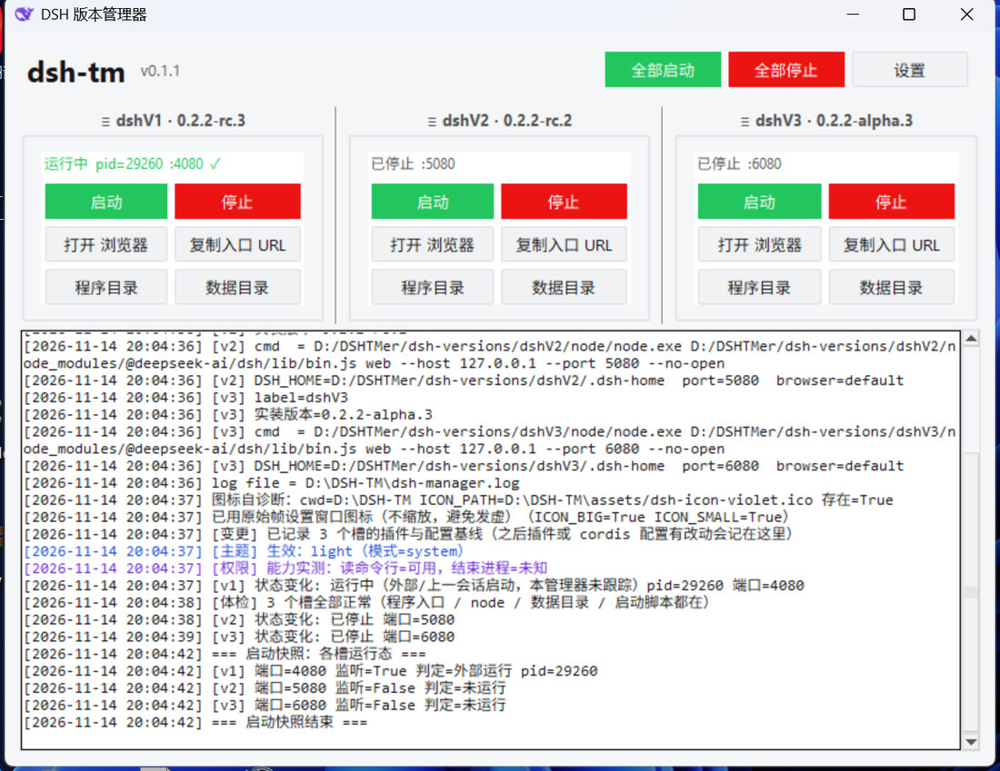
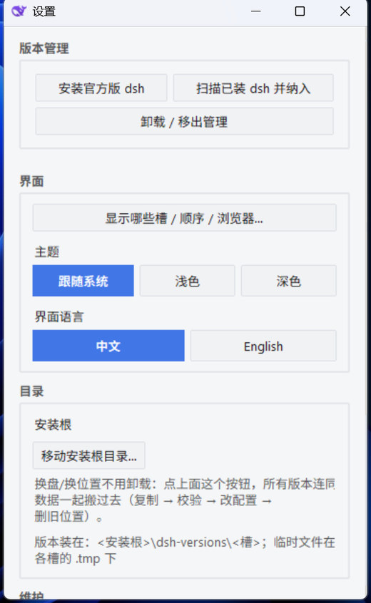

# DSH Manager (DSH-TM)

For the macOS app and source instructions, see [macOS setup](docs/macos.md). The batch and PowerShell examples below apply to Windows.

**English** · [中文](README.md)

[](https://github.com/arnen7000/dsh-tm/actions/workflows/ci.yml)
[](https://github.com/arnen7000/dsh-tm/releases)

Run several **mutually isolated DeepSeek Harness (dsh)** versions side by side on one
Windows or macOS machine, and drive them all from a single window.

> Each version gets its own process, port, data directory, bundled `node` runtime and temp
> directory. Keep your daily driver untouched while you test a new build; if the new one
> breaks, delete it and reinstall — nothing else is affected.

**Up to 6 versions.** GUI in **Chinese and English** (switch in Settings, takes effect immediately).

> ### ⬇ Download
> Download a trial package from [v0.1.11-preview.2](https://github.com/arnen7000/dsh-tm/releases/tag/v0.1.11-preview.2).
>
> - **Windows x64** — unzip `dsh-tm-0.1.11-portable.zip` and double-click `start-manager.bat`.
> - **Mac** — choose `macos-arm64` for Apple Silicon or `macos-x64` for Intel. Unzip and open `DSH-TM.app`. See [macOS setup](docs/macos.md).
>
> Both packages include Python and Node.



*(Screenshot shows the Chinese UI; the English UI is identical in layout.)*

## Why

Running two dsh versions normally means fighting over one `~/.dsh`, one port, one global
`node_modules`. This manager gives each version a fully separate slot:

| | Per slot |
|---|---|
| Process | its own `node` process |
| Port | its own `--port` (4080 / 5080 / 7080 …) |
| Data | its own `DSH_HOME` (`.dsh-home` inside the slot) |
| Runtime | its own bundled `node` |
| Temp | its own `TEMP` / `TMP` |

## Requirements

- Windows 10 / 11
- The bundled `runtime\python\pythonw.exe` (3.8+ with tkinter), or a system Python with tkinter
- **No** host Node.js needed — every slot carries its own
- ~0.7–1.3 GB of disk per version

Check your machine before installing. The portable package bundles Python, so there is
no need to install anything — just call the bundled interpreter:

```bat
runtime\python\python.exe scripts\check-env.py --lang en
```

(From a source checkout, use `python scripts\check-env.py --lang en` instead.)

## Quick start

1. Unpack the release anywhere (e.g. `D:\DSH-TM`).
2. Double-click `start-manager.bat` (or the desktop shortcut).
3. The first install or adopt asks **where to put versions** — that location is then locked.
   To change it later use **Settings → Directories → Move install root…** (moves every
   version together with its data; no uninstall needed).

## Interface

Each slot is one card: status line, **Start / Stop**, **Open browser** (carries the login
token), **Copy URL**, **Program dir**, **Data dir**. Drag a card to reorder.

Everything that changes the installation lives in **Settings**:

| Group | What's in it |
|---|---|
| Version management | Install official dsh / Scan and adopt / Uninstall & detach |
| Interface | which slots to show, order, browser, theme, **interface language** |
| Directories | install root, temp root, move |
| Maintenance | environment check, slot health check, regenerate bats, user guide |
| Log | view, clear, open the log file |



## Managing versions

**Install** — Settings → Version management → *Install official dsh*, pick a version
(or type `latest` / `next` / a specific number). Downloads from the npm registry and falls
back to `registry.npmmirror.com` automatically on `ECONNRESET` / timeout.
You can keep using other versions while it installs — the progress window does not lock the
main window.

**Adopt an existing dsh** — *Scan and adopt* lists everything it finds outside the managed
set. Two paths per entry:

- **Re-attach in place** — config only, seconds (for directories already under the version root)
- **Copy** — copies into the version root (hundreds of MB, slower); the original is untouched

Both run the same health check: missing `bin.js` or missing dependencies is refused with a
clear reason instead of "looks fine, explodes on start". Neither path repairs anything
in the source install — adopting only copies and registers a dsh that already runs.

**Uninstall vs detach**

- **Uninstall** stops the process, backs up user data (`.dsh-home` — sessions / credentials /
  plugin config), then deletes the slot directory. Anything **you** put there is deleted too
  and not backed up; the confirmation dialog names those files.
- **Detach** only removes the slot from `config.json`. Not one byte on disk changes —
  `dsh.bat` / `kill-<port>.bat` / `dsh-cli.bat` stay in the slot, so double-clicking still
  starts it. Re-adopt it later as-is (same port, no copying).

**Slot health check** — reports how the current state differs from what is registered.
Read-only by default; pick a slot and click **Repair…** to fill in only what is missing
(the node runtime, empty `.dsh-home` / `.tmp` directories, and **missing**
`dsh.bat` / `dsh-cli.bat` / `kill-<port>.bat`). The confirmation dialog lists exactly
which files will be created. Existing files — including bats you edited by hand — are
never deleted or overwritten. A bat whose *contents* are wrong (port / `TEMP` mismatch)
is outside Repair's scope; use Settings → Maintenance →
"Generate start / kill / CLI bats" for that.

**Upgrading from an older version** — download the new zip and **unzip it over the
existing folder**. `config.json` and the slots are not inside the package, so they are
never overwritten. **Do not delete the old folder first** — that removes `config.json`
too, which is effectively a reinstall. From source: `git pull` and restart the manager.
After upgrading, run the slot health check once.
Details (rollback, regenerating bats, source users): [user guide §3](docs/user-guide.en.md).

## Command line

```bat
python dsh-tm.py list
python dsh-tm.py start --all
python dsh-tm.py stop --all
python dsh-tm.py health
python dsh-tm.py doctor --json       :: one-shot diagnosis (read-only)
python dsh-tm.py --lang en list      :: English output
python dsh-tm.py list --json         :: machine-readable
python dsh-tm.py start v1 --json     :: write commands too
```

`--lang` also works as `--lang=en`. Without it, the CLI follows `ui.lang` in `config.json`.

**Every command supports `--json`**, emitting exactly one JSON object on stdout with a
fixed envelope (`schema_version`, `command`, `effect`, `ok`, `count`, `slots`,
`errors`). Field names and enum values are always English regardless of `--lang`;
free-text `detail` follows `--lang` and must not be parsed. `effect` is the command's
class (`read` / `runtime_write`) from `CMD_CLASS` — the CLI refuses to dispatch if a
command is unclassified or if any class is `disk_write`, so a script can never
accidentally uninstall anything. Write commands add `changed[]` and per-slot
`state` / `listening`, and never default to all slots. Disk-changing operations
(install / adopt / uninstall) are GUI-only. Read commands add `unknown_slots[]`
when a named slot does not exist. See the
[Agent API contract](docs/agent-api.md) for the full schema, error codes and examples.

**`doctor --json`** is the one-shot read-only diagnosis: it merges config validation,
the slot health check and the slot-shape check, and labels every issue with a fixed
English `code` / `source` / `action` plus per-slot `actions[]` (`fix_config`,
`reinstall_slot`, `regenerate_bats`, `create_data_dir`, `review_manually`).
Unlike `health --json`, an agent can classify these without parsing free text.

Every JSON result also carries `config_problems[]`. A malformed `versions` section is
reported as a structured config error (exit `3`) instead of being silently mistaken
for "no slots installed"; a `port` / `--port` mismatch is reported on read commands
and makes `start` / `stop` refuse the affected slots (`config_port_invalid`) rather
than acting on a wrong port. The GUI, the CLI and `doctor` share one implementation
in `dsh_config_guard.py`.

## Configuration

`config.json` is generated on first run from `config/config.example.json`.

Paths use placeholders so the whole tree can be moved or copied to another machine:

| Placeholder | Expands to |
|---|---|
| `<base>` | the install root |
| `<home>` | the user profile |
| `<self>` | this manager's directory |
| `<npm_global>` | the npm global prefix |

Three rules for hand-editing:

1. `port` and `extra_args`'s `--port` must be **the same**, or the status never updates.
2. Keep the placeholders — do not write absolute drive letters.
3. Stop the manager before editing (it keeps config in memory).

## Troubleshooting

**Nothing happens when I double-click.** Check `dsh-manager.log`. If tkinter is missing you
get a native message box explaining it (the `.pyw` has no console).

**A version shows "Stopped" but the port is busy.** Something else holds the port. The card
shows the owner; the manager never kills a process it did not start.

**A `dshV2-2` directory appeared.** A leftover directory held that number. New installs skip
numbers whose directories still exist on disk.

**Can I run two versions at once?** Yes — that's the whole point. Each has its own port,
data directory and runtime.

## Documentation

| Document | Language |
|---|---|
| [User guide (English)](docs/user-guide.en.md) | English |
| [Agent API contract](docs/agent-api.md) | English + Chinese |
| [README (Chinese)](README.md) | Chinese |
| [FAQ](docs/常见问题.md) | Chinese |
| [Security policy](SECURITY.md) | English + Chinese |
| [Contributing](CONTRIBUTING.md) | English + Chinese |
| [Changelog](CHANGELOG.md) | Chinese |

Architecture and release docs are Chinese-only — their audience is contributors and
maintainers, and the code itself plus `CONTRIBUTING.md` covers what you need to change it.

## License

[MIT](LICENSE)
