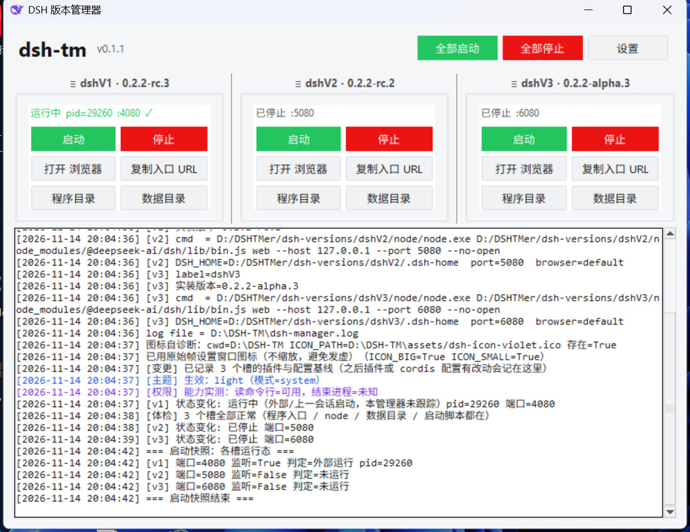
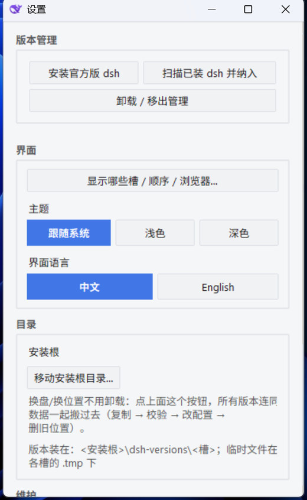

# dsh 版本管理器（dsh-tm）

**中文** · [English](README.en.md)

[](https://github.com/arnen7000/dsh-tm/actions/workflows/ci.yml)
[](https://github.com/arnen7000/dsh-tm/releases)

在同一台 Windows 机器上**并行运行多个互相隔离的 DeepSeek Harness（dsh）版本**，并用一个图形界面统一管理：安装 / 纳入 / 启动 / 停止 / 打开浏览器 / 卸载 / 移出 / 体检。

> **一句话**：每个版本一套自己的进程、端口、数据目录、node 运行时和临时目录，互不污染。主力版本日常用，新版本隔离着装，试坏了删掉重装，不碰主力环境。

**支持 1~6 个版本并存。**

> ### ⬇ 下载
> **[Releases 页面](https://github.com/arnen7000/dsh-tm/releases)** → 下 `dsh-tm-<版本>-portable.zip`
> → 解压到任意目录 → 双击 `start-manager.bat`。
> **不用装 Python、不用装 Node**，包里都带了。

---

## 界面



三张卡片就是三个互相隔离的版本：各自的状态行（`运行中 pid=29260 :4080 ✓` / `已停止 :5080`）、
启动 / 停止、打开浏览器（自动带上登录 token）、程序与数据目录。上面一行是全部启停和设置，
下面滚动区是实时日志（含 dsh 自己的 stdout/stderr，token 自动打码）。

标题栏点「设置」打开侧栏 —— 安装 / 纳入 / 卸载收在「版本管理」，主题与界面语言在「界面」，
安装根在「目录」，环境检查与槽体检在「维护」：



---

## 目录

- [界面](#界面)
- [一、它解决什么问题](#一它解决什么问题)
- [二、安装依赖](#二安装依赖)
  - [2.1 两种获取方式](#21-两种获取方式)
  - [2.2 依赖清单](#22-依赖清单)
  - [2.3 自行检查环境](#23-自行检查环境)
- [三、快速开始](#三快速开始)
- [四、使用说明（全场景）](#四使用说明全场景)
- [五、配置文件参考](#五配置文件参考)
- [六、注意事项与限制](#六注意事项与限制)
- [七、故障排查](#七故障排查)
- [八、内部机制（给要改代码的人）](#八内部机制给要改代码的人)
- [九、文档索引](#九文档索引)

---

## 一、它解决什么问题

**dsh（DeepSeek Harness）** 是一个基于 Cordis 框架、"一切皆插件"的 Agent 运行时，通过网页界面使用，通过 npm 分发（`@deepseek-ai/dsh`）。

想在同一台电脑上**同时留着几个不同版本**时（留一个稳定版、再试一个新版新插件、验证升级），如果它们共用同一份数据目录或同一个端口，就会互相踩：A 的配置被 B 覆盖、谁都抢不到端口、一个崩了拖累另一个。

本项目用**五条隔离轴**把它们彻底分开：

| 隔离轴 | 分开什么 | 怎么分 |
|---|---|---|
| ① 进程 | 各跑各的 node，内存不共享 | 每个版本用**自己的 node 运行时**启动自己的 `bin.js` |
| ② 数据 | 会话 / 配置 / 凭据 | 每版本独立的 `.dsh-home` |
| ③ 端口 | 监听端口 | 按槽序取 4080 / 5080 / 6080 / 7080 / 8080（**不特意避开 6080/8080**）；先查 config 再真实 bind 探测，撞了在 200 个端口内就近顺延，整段被占退到 20000–29999 |
| ④ 运行时 | node 版本与 ABI | 每槽自带一份 node，装依赖和运行期用**同一份**，原生模块不会 ABI 不匹配 |
| ⑤ 临时目录 | TEMP 落点 | 每槽独立的 `temp_dir`，缺省跟着安装根走 |

这五条**缺一不可**。只做数据隔离但共用端口，两个版本仍然只有一个能起来。

**重要边界**：本管理器只管 **npm 分发的 CLI 版 dsh**。桌面版（Electron、`app.asar` 打包态）**看不到也管不了**，两者互不干扰——详见 [6.1 不支持的范围](#61-不支持的范围)。

---

## 二、安装依赖

### 2.1 两种获取方式

**推荐走便携包**：解压 → 双击 `start-manager.bat` → 直接用。什么都不用装。

| 你怎么拿到本项目 | 需要先装什么 | 适合谁 |
|---|---|---|
| **便携包**（[Releases](https://github.com/arnen7000/dsh-tm/releases) 页面的 `dsh-tm-<版本>-portable.zip`，约 53 MB） | **什么都不用装** | **绝大多数人**。包内自带 `runtime\python`（3.10，含 tkinter）与 `runtime\node`（v24.21.0），解压即用，不联网 |
| **源码**（`git clone` / 下 zip） | **Python ≥ 3.8（带 tkinter）** + **Node.js ≥ 22.19** | 想改代码、或自己打便携包的人。仓库**不含** `runtime/`（200+ MB，被 `.gitignore` 排除） |

> 便携包是怎么来的：`python scripts/make-portable.py` 把源码 + 精简过的 runtime
> （去掉 62 MB 的 `.pdb` 调试符号和编译期文件）打成一个 zip。
> 换机器时也可以直接把整个目录拷过去，见 [4.12 换机器与便携](#412-换机器与便携)。

### 2.2 依赖清单

| 依赖 | 版本要求 | 用途 | 缺了会怎样 |
|---|---|---|---|
| **Python** | **≥ 3.8**（推荐 3.10+） | 跑管理器 GUI、安装/卸载逻辑 | 管理器起不来。**必须带 tkinter** |
| **Node.js** | **≥ 22.19**（各 dsh 版本要求不同，0.2.2 要 ≥ 24.9） | 跑 dsh 本体；装槽时用它跑 npm | 「安装官方版 dsh」会明确报错「找不到可用的 node.exe」，不会静默装坏 |
| **git** | 任意近代版本 | 只在你想 `git clone` / `git pull` 更新源码时用到 | 不影响管理器任何功能 |
| **第三方库** | **无** | 只用标准库 | — |
| **操作系统** | Windows 10 / 11（x64） | 用了 `ctypes` 调 Win32 API、`netstat`、`tasklist`、`taskkill` | 非 Windows 一律报错退出 |

**关于 tkinter**：它是 CPython 自带模块，但**不是所有发行版都带**。

- Windows：用 [python.org 官方版](https://www.python.org/downloads/)，安装时勾选 **tcl/tk** 组件；
- 精简版 / 某些 Store 版 Python 不含它；
- 如果管理器检测到 `import tkinter` 失败，会**自动改用包内的 `runtime\python\pythonw.exe` 重开自己**；包内也没有才弹窗说明原因，不会静默失败。

**关于 Python 3.8 这条线**：代码刻意不使用 3.9+ 的专有语法（`match`、`X | Y` 类型注解、`removeprefix`、`dict | dict` 等），`scripts/check-env.py` 与提交钩子会持续校验。

### 2.3 自行检查环境

任何时候都可以跑一次环境自检（只读，不改任何东西）：

```bat
:: 从源码跑（本机已装 Python）
python scripts\check-env.py

:: 便携包（用包内自带的 Python，什么都不用装）
runtime\python\python.exe scripts\check-env.py
```

它会逐项检查 Python 版本、tkinter、Node.js、文件完整性、端口占用、管理员权限，并**明确告诉你缺什么、怎么补**，最后给出退出码（0 = 全部满足）。

> 管理器界面里**没有常驻的环境检查入口** —— 它查的是管理器自己的前置条件（Python / tkinter / node / 权限 / 端口），而管理器既然已经打开了，这些基本必然通过。按槽的完整性交给「[槽体检](#411-槽体检)」，更准也更实用。
>
> 唯一的界面入口在**零槽引导卡**里（一个版本都没装时）：那是"我这台机器到底行不行"最需要被回答的场合。

---

## 三、快速开始

```
1. 解压 / clone 本仓库到任意目录（路径建议无空格、无中文）
   · **从源码跑需要 Python ≥ 3.8（带 tkinter）**，装 dsh 时还需要 Node ≥ 22.19；
     便携包自带这两个运行时，什么都不用装。详见 [2.1](#21-两种获取方式)
   · 不确定机器行不行？先跑 `python scripts\check-env.py`，它会逐项告诉你缺什么
        │
        ▼
2. 双击  start-manager.bat          ← 只打开管理器窗口，不装任何东西
        │
        ▼
3. 点零槽引导卡的「安装 dsh」（或「设置 → 版本管理 → 安装官方版 dsh」）→ 从版本列表里选一个（也可手填版本号）
   · 因为此时一个槽都没有，会先弹「把 dsh 版本放在哪」——选好后**锁定**
   · 缺省 = 你的用户主目录；**装完再想换位置不用卸载** —— 「设置 → 目录 → 移动安装根目录…」整体搬过去
   · 版本列表来自 npm registry，标出 最新 / 预览 / 已弃用
        │
        ▼
4. 卡片上点「启动」→ 点「打开浏览器」→ 开始用
   想再装一个？到「设置 → 版本管理」再点一次「安装官方版 dsh」，自动装进下一个空槽
```

**装完你会得到**：若干互不干扰的 dsh 版本，每个在槽目录里都有三件 bat（见 [4.13](#413-不用管理器直接跑某个版本)），**管理器删了也能自己跑**。

想要桌面图标：`python build_lnk.py` 会在桌面生成带图标的 `dsh-manager.lnk`（只用标准库，不需要额外装包）。不想跑脚本，右键 `start-manager.bat` →「发送到 → 桌面快捷方式」也一样。

### 仓库里的 .bat 各干什么（别点错）

| 文件 | 作用 | 什么时候用 |
|---|---|---|
| **`start-manager.bat`** | **只打开管理器窗口**，不装任何东西 | 日常使用（也可以用桌面快捷方式） |
| `start-manager-debug.bat` | 用带控制台的 Python 打开，异常直接打印在窗口里 | 「双击没反应」时排查 |
| `uninstall-here.bat` | 卸载器（先备份用户数据再删），是 `scripts\uninstall.ps1` 的双击入口 | 想从命令行 / 图形外卸载 |

> `start-manager.bat` **只开窗口**，装 dsh 版本一律在「设置 → 版本管理」里点「安装官方版 dsh」（零槽时首屏引导卡是同一个入口的快捷方式）——仓库里没有任何「一键装 dsh」的脚本，避免和安装流程打架。

> ⚠️ **`.bat` 一律是 GBK + CRLF + 无 BOM 编码**（`cmd.exe` 按系统 ANSI 代码页读它）。用编辑器改过之后请存回 ANSI，否则中文会变成乱码命令。仓库有 `scripts\fix-bat-encoding.py --check` 守着这条。

---

## 四、使用说明（全场景）

### 4.1 安装一个版本

打开标题栏 **「设置」→「版本管理」→「安装官方版 dsh」**（零槽时首屏引导卡的「安装 dsh」是同一个入口）。弹窗里：

- 上半部分是**版本列表**，来自 npm registry，实时拉取，标注「最新 / 预览 / 已弃用」；
- 也可以直接在输入框**手填**版本号（如 `0.2.0-rc.2`）或 `latest`；
- **输入框是唯一的事实来源** —— 列表只是帮你填进输入框。

管理器会依次完成：建槽目录 → 用本槽（或包内）node 跑 `npm init -y` 和 `npm install` → 写 `config.json` → 生成三件 bat → 复核槽形态。失败会当场收回半成品（不留 `dshV1-2` 这种残壳）。

**网络失败自动回退**：官方源连不上时（典型是 `npm error errno -4077 / ECONNRESET`）会自动改用 `registry.npmmirror.com` 重试一次，**只对本次命令生效，不改你的全局 npm 配置**。

### 4.2 一次装多个

同一个弹窗支持 **Ctrl 点选 / Shift 连选**多个版本，也可以在输入框里用逗号或空格分隔写多个。

- 上限 = **还有几个空槽**（`MAX_SLOTS - 已有槽数`），窗口标题会直接写出"一次最多 N 个"；
- **输入框始终是唯一的事实来源**：从列表多选只是帮你把版本号填进输入框，你也可以直接手写；
- 装的顺序就是选的顺序，每个落到下一个空槽。

某个装失败**不会中断队列**，其余继续装；全部结束后**一次性刷新界面**（不重启进程），新槽直接出现在卡片区。

### 4.3 纳入已有的 dsh

你的电脑上已经有一份装好的 dsh（比如以前手工 npm 装的），不想重装？点「**设置 → 版本管理 → 扫描已装 dsh 并纳入**」：

1. 扫描当前版本根与 npm 全局 `node_modules`，列出所有 `@deepseek-ai/dsh`；
2. 勾选要纳入的 → 管理器**复制**成独立槽（复制时**不跟随 junction**，链接会被重新指向新槽）；
3. 槽外指向的链接如果目标丢失，会如实记进"丢失清单"，不会伪造。

**扫描只在你点「扫描已装 dsh 并纳入」时发生**（启动时不扫、不弹窗）。每次都重新查磁盘（npm 全局 + 当前版本根），判据只有一条：这个目录此刻在不在 `config.json` 的 `versions` 里 —— 在就不出现（它已经在管），不在且有完整安装就出现。勾了就纳入，不勾就什么都不做，也不记任何「以后不再提示」的名单。

> **目录已被删掉的旧记录不会被当成安装**：`config.json` 里的 `detached` 只是「上次移出时它在哪」的路径提示，扫描会先复核目录是否还在、有没有完整的 `lib/bin.js`、是不是已经在管。失效记录不会出现在扫描结果或提示文字里 —— 界面上一个字都不提，只在日志里记个数。记录本身保留（可能是移动盘 / 网络盘暂时离线），盘接回来后自动重新生效。

> 启动时**不扫描**，所以不会有意外的弹窗。
>
> 手动「扫描并纳入」会把**版本根下已移出的槽目录**也列出来 —— 勾选后是**原地接回**（只改配置、不复制文件）。版本根之外的安装才需要复制一份进来。

### 4.4 启动 / 打开浏览器 / 停止

每个槽的卡片上有：

| 按钮 | 作用 |
|---|---|
| **启动** | 用该槽的 node 拉起 `bin.js` + 该槽的 `extra_args`（缺省 `web --host 127.0.0.1 --port <该槽端口> --no-open`），并注入该槽的 `DSH_HOME` / `TEMP` |
| **停止** | 按**签名 + 端口**杀该槽的 dsh 进程（绝不"见端口就杀"） |
| **打开 Chrome / Edge / Firefox / 浏览器** | 打开 `http://127.0.0.1:<port>`，自动带 token |
| **复制入口 URL** | 复制带 token 的完整 URL 到剪贴板（日志里的 token 已打码） |
| **程序目录 / 数据目录** | 在资源管理器里打开该槽目录 / `.dsh-home` |

状态行实时显示 `运行中 pid=xxx` 或 `已停止 :端口`。

**停止的安全边界**：只有「命令行里带该槽 `bin.js` 绝对路径」或「该槽端口上有 node 在听」才认为是 dsh。端口被**非 dsh** 程序占用时**拒绝杀**，只告警——绝不误杀别的软件。

标题栏的 **「全部启动」/「全部停止」**：把本管理器管的每个槽挨个拉起 / 停一遍（走同一套签名 + 端口门控）。
停止在**后台线程**里逐个执行，界面不卡（枚举进程 + 识别端口占用者都很慢，4 个槽同步跑会冻住界面）。

> **2026-11-01 起「杀全部进程」按钮已从界面移除**（它和「全部停止」日常效果几乎一样，
> 两个并排会让人犹豫）。它独有的价值只剩"清理没登记进 config 的 dsh 残留"，
> 属于排障动作 —— 移到命令行：`python dsh-tm.py kill-stray --yes`。
> 该命令同样只认 `@deepseek-ai/dsh` 签名，不碰其它应用的 node。

### 4.5 换某个槽的版本

**2026-10-30 起没有「换版本」按钮了**，因为"原地换"容易留下一半旧一半新的残局。推荐做法：

1. **「设置 → 版本管理 → 卸载 / 移出管理」→ 卸载选中**（会先备份 `.dsh-home` 全部内容 + 插件清单 + 实装版本号）；
2. 空出来的槽位再到「设置 → 版本管理」点 **「安装官方版 dsh」** 装新版本；
3. 需要旧数据时，把备份里的 `.dsh-home` 内容拷回新槽的 `.dsh-home`。

备份目录：`<安装根>\dsh备份\<槽名>-userdata-<时间戳>\`，里面 `_meta.json` 记着实装版本号与来源。

### 4.6 安装 / 移出 / 纳入：三者关系

三个动作都只做一件事，边界如下：

| 动作 | 入口 | 做什么 | 磁盘 | config |
|---|---|---|---|---|
| **安装** | 设置 → 版本管理 → 安装官方版 dsh | 新建一个槽目录，从 npm 装一份 | 新增 `dsh-versions\dshV<N>` | 新增一条 `versions` 记录 |
| **移出管理** | 设置 → 版本管理 → 卸载 / 移出管理 | 只是「管理器不再管它」 | **一个字节都不动** | 删掉那条 `versions` 记录，只留一条路径提示 |
| **纳入** | 设置 → 版本管理 → 扫描已装 dsh 并纳入 | 把「磁盘上有、config 里没有」的安装收进来 | 版本根下的**原地接回**；别处的**复制**一份进来 | 新增一条 `versions` 记录 |

**四条硬约束**（2026-11-13 起，全部由代码保证）：

1. **槽键 ↔ 目录名 ↔ 显示名一一对应**：`v3` ↔ `dshV3` ↔ `dshV3`。纳入时槽键从目录名推导（`dshV3` → `v3`），绝不沿用旧记录里的键 —— 否则会出现「槽 v4 顶着 dshV3 的名字」这种两张卡片同名的幽灵槽。
2. **端口唯一**：登记前查全部已占用端口。接回时若 bat 里的端口已被别的槽占用，自动换一个空闲端口并**重写三件 bat**，不会写一个注定撞车的端口进配置。
3. **同一目录只能有一个槽**：目录已在 `versions` 里就拒绝重复纳入；扫描也永不把它列为候选。
4. **编号跟着目录走，永远不会出现 `dshV3-2`**：`v3` 就固定是 `dshV3`。目录还在磁盘上（哪怕已移出管理）就占着这个编号，新装自动跳到下一个空编号（`v4`）。零文件的空壳不算占用 —— 装之前会清掉复用。所以「移出 v3 后再装一个」得到的是 `v4`，不是 `dshV3-2`；要接着用 v3 就点「扫描并纳入」把它接回来。

「卸载 / 移出管理」窗口有**两个不同**的动作，别选错：

| | 卸载 | 移出管理 |
|---|---|---|
| 改什么 | 删整个槽目录 + 从 `config.json` 移除 | **只**从 `config.json` 移除 |
| 磁盘 | 先备份用户数据，再删程序产物 | **一个字节都不动** |
| 还能用吗 | 不能（除非从备份恢复） | **能** —— 双击槽里的 `dsh.bat` 照常启动 |
| 怎么回来 | 从备份恢复 / 重新安装 | 点「扫描已装 dsh 并纳入」，**原地接回**（不复制） |

**什么场面用「移出管理」**：想把这批版本放出来自己跑，再把管理器指到别的位置管另一批新版本。

流程：

1. 逐个「移出管理」现有槽（**运行中的槽要先点「停止」** —— 移出后管理器不再跟踪它的进程，你就没有「停止」入口了）；
2. 全部移出后，**安装根自动解锁**（锁定条件就是"有没有在管的槽"），在「设置 → 目录」改成新位置；
3. 装 / 纳入新的 dsh；
4. 想回头？点「**扫描已装 dsh 并纳入**」，它会重新发现这个槽并**原样接回**（只改 config、不复制文件）。目录已被删掉的不会出现在结果里。

移出记录（`config.json` 顶层 `detached`）里**只存绝对路径**，不存槽名 / 端口 / 旧配置 —— 那些字段描述的是"当时那个槽"，接回时槽键可能已经变了，照抄就会造出与现役槽同名、同端口、同目录的幽灵槽。

> 为什么还要留这条路径：换过安装根之后，旧位置的槽不在扫描范围内（只扫当前版本根和 npm 全局），没有这份记录就再也自动发现不了它们。记录只是「去哪找」，接回时一切以磁盘为准。

### 4.7 卸载

**管理器里卸（推荐）**：「设置 → 版本管理 → 卸载 / 移出管理」→ 选一个槽（**一次一个**）→「卸载选中」→ 确认。

**命令行卸**：

```powershell
# 先看计划（零副作用，强烈建议每次先跑）
powershell -NoProfile -ExecutionPolicy Bypass -File scripts\uninstall.ps1 -Target v2 -DryRun

# 真删（会先备份）
powershell -NoProfile -ExecutionPolicy Bypass -File scripts\uninstall.ps1 -Target v2

# 卸掉 config.json 里的全部槽
powershell -NoProfile -ExecutionPolicy Bypass -File scripts\uninstall.ps1 -Target all
```

参数：`-Target`（槽键或 `all`，缺省交互选择）、`-DryRun`、`-Yes`、`-SkipBackup`、`-SkipGlobal`、`-Base`、`-ConfigPath`。

**备份与删除的边界**：

| 类别 | 内容 | 卸载时 |
|---|---|---|
| 用户数据 | 该槽的 `.dsh-home`（会话 / 配置 / 凭据 / 插件配置） | **只备份、可原样取回** |
| 用户改过的配置 | `config.json` | 改前自动备份为 `config.json.bak-<时间戳>` |
| 程序产物 | `node_modules\`、自带 `node\`、三件 bat、`package.json` | **删除** |
| 临时目录 | 各槽的 `temp_dir` | **保留**（不在槽目录内时不归槽所有） |
| 仓库源码 | README / 脚本 / 图标 / `config.example.json` | **不动** |

> ⚠️ **你自己放进槽目录的东西（笔记、补丁、下载的文件）会跟着一起删且不进备份。** 要留请先复制出去。
> 卸载确认框会把这类「不是 dsh 装出来的」条目**逐个点名列出**（`node_modules` / `node` / `.dsh-home` / `.tmp` / 三件 bat / `package*.json` 之外的都算）。

**备份要么完整、要么中止**：备份后会逐文件核对大小；对不上就把备份目录改名成 `-INCOMPLETE` 并中止卸载，绝不留下"看着正常其实缺文件"的假备份。

### 4.8 备份与恢复

**备份在哪**：`<安装根>\dsh备份\<槽名>-userdata-<时间戳>\`

**里面有什么**：`.dsh-home` 的全部内容（会话、设置、凭据、插件配置）+ 插件清单 `package.json` / `package-lock.json` + `_meta.json`（实装版本号与来源）。

**恢复**：

1. 先在管理器里装一个同版本（或兼容版本）的槽；
2. 停掉它（别在运行中改数据目录）；
3. 把备份里的 `.dsh-home` 内容覆盖到新槽的 `.dsh-home`；
4. 启动。

> 备份里的 `profiles\node_modules\*` 是**真目录**（备份时解引用 junction），完整自包含。装回去之后 dsh 会按需重建链接。

### 4.9 界面显示偏好与拖动排序

标题栏 **「设置」** 打开一个窗口，里面分五组：**版本管理**（安装 / 纳入 / 卸载 · 移出）、**界面**（显示哪些槽、顺序、主题、**界面语言**）、**目录**（安装根）、**维护**（环境检查 / 槽体检 / 生成 bat / 使用说明）、**日志**（大小与清理）。主界面只留槽 + 日志 + 全启停，装/纳入/卸载这些动作统一收在「版本管理」里。

界面支持**中英双语**：设置 → 界面 → 「界面语言」切 中文 / English，**切换立即生效、不用重启**。
英文模式下「使用说明」会打开 [`docs/user-guide.en.md`](docs/user-guide.en.md)。

界面设置可以决定**显示哪几个槽、最多显示几个、左右顺序**：

- **隐藏 ≠ 卸载**：隐藏只决定画不画卡片。进程跟踪、端口、数据目录、卸载名单永远是**全量**，改完**立即生效**，不用重启。
- **三种排序方式**（效果一样，都是写 `ui.order`）：主窗口**直接拖卡片**、设置窗里拖行、或用「上移 ↑ / 下移 ↓」按钮。
- **拖动排序的手感**：按住卡片**任意位置**（含按钮）往外拖 —— 卡片会浮起来跟着鼠标走，其它卡片实时让位，松手落下即生效。鼠标移到卡片空白处会变成**四向箭头**，那就是"这里能拖"的信号（卡片上不写文字提示）。
- **把全部槽都隐藏了**也没关系：界面会换成一张提示卡，上面有「打开设置…」按钮，不会变成一片空白让人以为程序坏了。

浏览器在「界面」组里改（「显示哪些槽 / 顺序 / 浏览器…」）：下拉选 系统默认 / Chrome / Edge / Firefox / 选择其他程序…。**没装的会标注「（未安装）」**，选它也不报错，会兜底到系统默认。新装的槽默认就是系统默认浏览器。

### 4.10 自定义位置（安装根）

标题栏 **「设置 → 目录」** 有两行：

| 项 | 能不能改 | 说明 |
|---|---|---|
| **安装根目录** | **只在还没有任何槽时可改**，装第一个版本/纳入时锁定 | 换位置等于搬家：备份目录、临时目录、空壳扫描、新槽落点全都跟着变。所以定在第一次，代价最小。改完**要重启管理器**才生效 |

**两者不能一次同时改**：那会算出"基于新安装根、但槽还没搬过去"的临时目录，等于把 TEMP 指到一片空地。要换两处请分两步，先改安装根并保存，再回来改临时目录。

**想换安装根但已经有槽了**？两条路：

1. **整体移动**（推荐，2026-11-01 新增）：**「设置 → 目录 → 移动安装根目录…」**。
   把所有已装版本搬到新位置，适合换盘或整理目录。过程是
   **复制 → 校验（文件数 + 字节数）→ 改配置 → 删旧位置**，任何一步失败都保留旧位置。
   搬家时**不跟随 junction / 符号链接**；目标已有同名目录一律中止。
2. 把槽全部「移出管理」（或卸载），锁自动解开 —— 因为锁定条件就是"有没有在管的槽"。

**临时文件的落点**：新装/新纳入的槽固定放在 `<槽目录>\.tmp`（2026-11-02 起）。
所以目录设置里**只需要一个安装根**，不必再管临时目录。已装的旧槽保持原路径不动。

> 想省 C 盘，要改的是**安装根**而不是临时目录：真正占盘的是槽本身（`node_modules`，每槽 0.7–1.3 GB），临时目录通常只有几百 KB 到几 MB。

**手改 `temp_dir` 之后必须点一次「生成启动/kill/CLI bat」**，否则 `dsh.bat` 里的 `set "TEMP=..."` 还是旧路径。「槽体检」会检查这条（只报不修）。

**关于 `dsh-versions\` 下能不能放别的东西**：可以，但**不要删或改 `dshV1`…`dshV6`**——它们是槽本体。
其余常见条目：

| 条目 | 谁建的 | 说明 |
|---|---|---|
| `dshV1`…`dshV6` | dsh-tm | 版本槽本体，搬移/卸载都由管理器负责 |
| `<槽>\.tmp\` | dsh-tm | 该槽的临时目录（TEMP 落点） |
| `.plugin-install-backup-<时间>-<来源>` | **dsh 自己**（桌面版装插件时） | 插件安装前的 profile 备份；dsh-tm 不读也不删 |

> 那个 `.plugin-install-backup-*` 是 **dsh 的行为**，不是本管理器的。它和槽并列在
> `dsh-versions\` 下，只是因为 dsh 的 profile 恰好装在那里。管理器扫描 / 体检时不会碰它。

### 4.11 槽体检

入口：**「设置 → 维护 → 槽体检」**（排障工具，日常用不上；「关于」窗口里也有一个同样的入口）。

它**默认一个字都不改**：只检查、只报告。窗口底部另有一个**显式的「修复…」**（下拉里只列有错误/警告的槽），
**点了才动**，而且只补不删（见下）。

它把这个槽"现在的样子"和"登记的样子"逐项对比，分三级报告：

| 级别 | 含义 | 例子 |
|---|---|---|
| **错误** | 现在起不来 | 缺 `bin.js`、缺 `node`、槽目录没了 |
| **警告** | 能跑，但迟早出事 | 用系统 node、原生模块 `node-pty` 缺失、端口与 kill bat 不符、两槽抢同一端口、`temp_dir` 与 bat 不一致 |
| **提示** | 只是信息 | 实装版本号、数据目录大小 |

为什么默认不修：槽里少了什么、多了什么，**可能是你故意的**（换了 node、给 dsh 打了补丁、把 `.dsh-home` 挪到别的盘）。
管理器自动"修好"等于覆盖你的选择，所以必须由你点一下。

**「修复…」能做什么**（铁律：只补、不删、不覆盖已有文件）：

| 缺什么 | 结果 |
|---|---|
| `node/node.exe` | 补：从其它槽或包内 `runtime/node` 复制一份 |
| `.dsh-home` / `.tmp` 目录 | 补：建空目录（原来的会话/凭据不会回来） |
| `dsh.bat` / `dsh-cli.bat` / `kill-<port>.bat` | 补：只补**缺失的**那几件，按当前配置重新生成；已存在或你手工改过的 bat 一律不碰 |
| `lib/bin.js`、依赖、dsh 的 `package.json` | **不补**（等于重装），当场说明并建议用「安装官方版 dsh」 |

确认框会先列清这次要生成哪些文件。补完会**再体检一次**；还有补不了的会如实告诉你，不会假报成功。
bat 内容写错（端口 / `TEMP` 与配置不符）**不在**修复范围内 —— 修复只补「文件不存在」，不重写已有文件；这种请用「设置 → 维护 → 生成启动/kill/CLI bat」重建。

报告窗口可以「复制到剪贴板」，方便贴出来排查。

### 4.12 换机器与便携

**把整个目录拷过去就行。** `config.json` 里的路径支持四个占位符，换用户名、换盘符都不断链：

| 占位符 | 含义 |
|---|---|
| `<base>` | 安装根目录 |
| `<home>` | 用户主目录（`%USERPROFILE%`） |
| `<self>` | 管理器自身所在目录 |
| `<npm_global>` | npm 全局 `node_modules` |

整个目录拷到新机器、放到相同位置即可用。

**目标机没有 Python / Node 怎么办**：把 `runtime\` 一起拷过去。

`runtime/python`（便携 CPython 3.10，含 tkinter）与 `runtime/node`（官方 win-x64 发行包）在本机是**存在但被 `.gitignore` 排除**的 —— 它不进 git，但复制目录时会一起带走。`start-manager.bat` 优先用 `runtime\python\pythonw.exe`，找不到才退回系统 PATH 上的 Python，所以目标机什么都不用装、也不联网。

拷之前建议先关掉管理器（避免复制到一半还在写日志/配置），拷完在新机器上双击 `start-manager.bat` 验证一遍。

**关键承诺**：管理器删了，各 dsh 版本仍能自己跑。槽里的三件 bat 全是绝对路径，不读 `config.json`、不读注册表。仓库有离线回归 `scripts\test-standalone.py` 用**真的 cmd.exe + 真的 node.exe** 守着这条（把 bat 生成时的 `BASE_DIR` 指向不存在的目录，等价于"管理器已被删掉"）。

### 4.12b 从旧版本升级

**便携包**：新 zip **解压覆盖到原目录**即可 —— `config.json` 和槽都不在包里，不会被覆盖。
**别先删旧目录**：那会连 `config.json` 一起没，等于重装。升级后建议跑一次「槽体检」。

**源码**：`git pull` 后重启管理器；`config.json` 与 `runtime/` 都不入库。

回滚、bat 重建、手改 bat 的注意事项见 [使用说明 §3](docs/dsh管理器使用说明.md)。

### 4.13 不用管理器，直接跑某个版本

每个槽目录里有三件 bat，双击即用：

| 文件 | 作用 |
|---|---|
| `dsh.bat` | 起 web 服务：`node bin.js web --no-open --port <该槽端口>` |
| `dsh-cli.bat` | 命令行模式：`node bin.js %*`，参数原样透传 |
| `kill-<端口>.bat` | 停掉该槽端口上的 dsh（走 `dsh_kill.py` 的签名门控） |

> **两条路的环境一致**：管理器里点「启动」和双击 `dsh.bat` 走的是同一个 `bin.js`、同一个 `DSH_HOME`、同一个 `TEMP`。区别只在管理器自己拉进程时用的是 `config.json` 里的 `extra_args`（`web --host 127.0.0.1 --port <端口> --no-open`）。

**关于 `dsh-cli.bat`**：dsh 的 CLI **没有交互式 REPL**，带参数会报 `--profile <name> is required`。正确用法：

```bat
dsh-cli.bat --profile headless
```

`headless` 可换成该槽 `.dsh-home\profiles\` 下已有的名字（常见 `headless` / `web`）。

如果 bat 报「找不到 dsh_kill.py」，说明管理器已被卸载或搬走 —— **dsh 本身不受影响**，bat 里会继续告诉你怎么用 `netstat` + 任务管理器手动停进程。

### 4.13b 命令行接口（CLI）

管理器还带一个**命令行入口** `dsh-tm.py`，与界面共用同一份 `config.json`、
同一套隔离语义（`DSH_HOME` / `TEMP` / 端口），但**不需要图形环境**，可用于脚本和计划任务。

```bat
python dsh-tm.py list                :: 列出所有槽与运行状态
python dsh-tm.py start --all         :: 启动全部（标题栏也有「全部启动」）
python dsh-tm.py stop  --all         :: 停止全部
python dsh-tm.py start v1 v3         :: 启动指定的几个
python dsh-tm.py url   v1            :: 打印入口地址（不含 token）
python dsh-tm.py health v1 --deep    :: 槽体检（只读）
python dsh-tm.py doctor --json       :: 综合诊断（只读）：配置 + 体检 + 槽形状 + 建议动作
```

| 参数 | 说明 |
|---|---|
| `--verbose` | 打印底层详细过程（排障用） |
| `--config <路径>` | 用别的配置文件（缺省同目录 `config.json`） |
| `--wait <秒>` | `start` 专用：等端口监听的超时，缺省 20 秒 |
| `--lang zh\|en` | 输出语言；不给则跟随 `config.json` 的 `ui.lang` |
| `--json` | **机器可读输出**（见下） |

退出码：`0` 全成功 / `1` 有失败 / `2` 用法错误 / `3` 配置错误。

**`--json`：给 agent / 脚本用**。**所有命令**（只读 + 写操作）都支持，输出固定 schema：

```bat
python dsh-tm.py list --json
python dsh-tm.py doctor --json            :: 排障总入口（只读）
python dsh-tm.py start v1 --json
python dsh-tm.py kill-stray --json        :: 只出计划，不加 --yes 不动任何进程
```

**`doctor --json`** 把「配置校验 + 槽体检 + 槽形状复核」合成一次只读结论：每条问题带
固定英文 `code` / `source` / `action`，槽级给 `actions[]`（`fix_config` /
`reinstall_slot` / `regenerate_bats` / `create_data_dir` / `review_manually`），
顶层给 `level` / `summary` / `config_valid`。`health --json` 只有随语言变的自由文本，
agent 要分类就走 `doctor`。

**配置可信度是明摆着的**：所有 `--json` 结果都带 `config_problems[]`。
类型写坏的 `versions` 现在直接结构化报错（退出码 3，**不再静默当成零槽**）；
`port` 与 `extra_args --port` 不一致时，读命令照常出报告但把问题列出来，
`start` / `stop` 会拒绝这些槽（`config_port_invalid`），不会拿错端口去启停进程。
GUI、CLI、`doctor` 用的是 `dsh_config_guard.py` 里同一份判据。

```json
{
  "schema_version": 1,
  "command": "list",
  "ok": true,
  "count": 1,
  "errors": [],
  "slots": [
    {"key": "v1", "label": "dshV1", "port": 4080, "state": "stopped",
     "version": "0.2.2-rc.3", "bin_js": "...", "dsh_home": "...",
     "temp_dir": "...", "browser": "default"}
  ]
}
```

写操作额外给 `changed[]`（状态真正翻转的槽）和逐槽 `ok` / `state` / `listening`；
失败项在 `errors[]` 里带固定英文 `code`（`spawn_failed` / `port_not_listening` /
`stop_failed` / `still_running` …）。

约定：

- **字段名与枚举值固定英文**（`running` / `stopped` / `ok` / `warning` / `error`），
  不跟 `--lang` 漂移 —— 机器读的东西不该随界面语言变
- 每个命令的顶层至少有 `schema_version` / `command` / `effect` / `ok` / `count` /
  `slots` / `errors`；加字段不升版本，**改已有字段名 / 枚举值 / `ok` 的含义要升**
- `effect` 取自 `dsh-tm.py` 的 `CMD_CLASS` 唯一分类表（`read` / `runtime_write`）。
  `main()` 有注册闸门：命令漏分类、分类表里混进 `disk_write` 都会当场失败，
  第 18 套回归还会把这张表与 `docs/agent-api.md` 逐项对账。写命令一律带
  `changed[]`，只读命令不带；给了未登记的槽名会带 `unknown_slots[]`
- **`ok` 有两种含义**：只读命令 = 命令跑通（槽是否健康看 `level`）；写操作 =
  目标状态真的达成（`start` 后端口要在听，`stop` 后端口要不通）
- 写操作不给槽、也不给 `--all` → `no_target`（退出码 2），**绝不默认全开**
- `health --json` 的每条问题带 `level` + `title` + `detail`，没指定槽就查全部；
  要固定英文分类与建议动作就用 `doctor --json`
- 每个结果都带 `config_problems[]`（空 = 配置可信）；配置不可用时 `--json`
  仍然输出一个 `ok: false` 的对象、退出码 3
- JSON 模式 `stdout` 只有一个 JSON 对象，诊断走 stderr
- 带 token 的完整入口 URL 只存在管理器进程内存里，CLI 拿不到 ——
  `url --json` 里 `has_token: false` 表示这只是裸地址
- 改磁盘的操作（安装 / 纳入 / 卸载）**不在 CLI 里**，脚本不可能误卸载

`--json` / `--lang` 写在子命令前后都行（`list --json` 和 `--json list` 等价）。
完整契约（读写分界、逐命令字段表、错误码、示例）见
[`docs/agent-api.md`](docs/agent-api.md)（中英双语）。

> **「全部启动」为什么两个入口都有？**
> 标题栏的「全部启动 / 全部停止」只作用于 config 里登记的这几个槽；CLI 的
> `start --all` 是给脚本 / 计划任务用的。多开会占内存与端口，不常驻时记得「全部停止」。

> **标题栏还有「全部启动」**（只启动 config 里登记的这几个槽）。
> 专做"清理槽外 dsh 残留"的是 CLI 的 **`kill-stray`** —— 它连没登记进 config 的
> dsh 副本也一起清，属于排障动作，不该占首页位置：
>
> ```bat
> python dsh-tm.py kill-stray          :: 只看计划，不动手
> python dsh-tm.py kill-stray --yes    :: 真的执行
> ```
>
> 两者都只认 `@deepseek-ai/dsh` 签名，绝不碰其它应用的 node 进程。

### 4.14 国内网络

管理器和 dsh 都**不依赖 GitHub**：管理器只有几十 MB，装好之后所有功能都走 npm。

| 情况 | 怎么办 |
|---|---|
| 下载本项目慢 | 让别人把装好的整个目录拷给你（见 [4.12](#412-换机器与便携)），**完全不需要访问 GitHub** |
| 装 dsh 时 npm 慢或超时 | 安装逻辑已内置**镜像回退**：官方源不通自动改用 `registry.npmmirror.com` 重试一次，只对本次命令生效 |
| 想强制走镜像 | `npm config set registry https://registry.npmmirror.com`（恢复：`npm config set registry https://registry.npmjs.org`） |

dsh 官方文档站（`deepseek-harness.github.io`）在国内可能打不开，但**不影响使用**——管理器不需要访问它。

### 4.15 选哪个版本

| 场景 | 建议 |
|---|---|
| 日常干活、装重要插件 | 停在 **rc 线**的稳定版本，出问题代价最小 |
| 想试新插件 / 新特性 | 单独一个槽装 alpha 或最新 rc，**玩坏了删掉重装，不碰主力槽** |
| 只是想知道有哪些版本 | 管理器弹窗里的列表就是全量（来自 npm registry）；命令行 `npm view @deepseek-ai/dsh versions` |

> dsh **没有独立下载页 / zip**，所有版本都从 npm registry 分发。"下载某个版本" = `npm i @deepseek-ai/dsh@<版本号>`。
>
> alpha 线功能最新，但文档 / 插件兼容可能滞后。

---

## 五、配置文件参考

管理器读自己所在目录下的 `config.json`。**仓库只提供模板** `config/config.example.json`（`config.json` 被 `.gitignore` 排除）。第一次启动时若没有 `config.json`，管理器会自动从模板复制一份。

零槽模板长这样：

```json
{
  "install_base": "<home>",
  "icon": "assets/dsh-icon-violet.ico",
  "versions": {}
}
```

装第一个版本后会自动长出 `versions` 段：

```json
{
  "install_base": "<home>",
  // temp_root 已废弃：临时文件固定放在各槽的 .tmp 下
  "versions": {
    "v1": {
      "label": "dshV1",
      "node_exe": "<base>/dsh-versions/dshV1/node/node.exe",
      "bin_js":   "<base>/dsh-versions/dshV1/node_modules/@deepseek-ai/dsh/lib/bin.js",
      "dsh_home": "<base>/dsh-versions/dshV1/.dsh-home",
      "temp_dir": "<base>/dsh-versions/dshV1/.tmp",
      "port": 4080,
      "browser": "default",
      "extra_args": ["web", "--host", "127.0.0.1", "--port", "4080", "--no-open"]
    }
  }
}
```

### 字段说明

| 字段 | 层 | 说明 |
|---|---|---|
| `install_base` | 顶层 | 安装根目录。**有槽之后锁定** |
| `temp_root` | 顶层 | **已废弃**，保留仅为兼容旧配置。临时文件固定在各槽 `.tmp` |
| `icon` | 顶层 | 窗口/快捷方式图标，相对管理器目录 |
| `versions` | 顶层 | 槽字典，键 `v1`…`v6`，最多 6 个（`MAX_SLOTS`） |
| `ui` | 顶层，可选 | `max_visible` / `order` / `visible`。管理器「设置」会写它，手写也行。**只影响渲染**，隐藏 ≠ 卸载 |
| `detached` | 顶层，可选 | 已移出的槽**在哪**（只存绝对路径）。管理器自动写，别手改 |
| `label` | 槽 | 槽目录名（如 `dshV1`），也是 bat 里显示的版本名 |
| `node_exe` | 槽 | 该槽自带 node 的 `node.exe` |
| `bin_js` | 槽 | dsh 入口 `lib/bin.js`，签名与槽根反推都靠它 |
| `dsh_home` | 槽 | 该槽的数据目录（`DSH_HOME`），**必须每槽独立** |
| `temp_dir` | 槽 | 该槽的 `TEMP`。改完要重建 bat |
| `port` | 槽 | 该槽 web 端口，**必须每槽独立** |
| `browser` | 槽 | `default` / `chrome` / `edge` / `firefox` / 任意 exe 绝对路径 |
| `extra_args` | 槽 | 传给 `bin.js` 的参数数组。**端口在这里也要跟着改**，否则预检与实起不一致 |

### 手改配置的三条硬规矩

1. **写文件必须无 BOM**。Python 的 `json.load` 遇 BOM 会直接崩，而管理器的自愈逻辑会把它判成坏配置。
   - 别用 PowerShell 5.1 的 `Set-Content -Encoding utf8`（它会写 BOM）；
   - 用编辑器的「UTF-8 无 BOM」，或让管理器自己改。
2. **改 `temp_dir` 之后必须重建 bat**（管理器里点「生成启动/kill/CLI bat」）。
3. **改完重启管理器** —— 它启动时只读一次配置。

管理器所有写配置的地方都是**原子写**（先写 `config.json.tmp-<pid>` 再 `os.replace`），并且改前自动备份为 `config.json.bak-<时间戳>`。解析失败时会备份成 `config.json.bad-<时间戳>` 再从模板重建，并**弹框告诉你**（不会静默覆盖）。

---

## 六、注意事项与限制

### 6.1 不支持的范围

| 场景 | 为什么 | 表现 |
|---|---|---|
| **dsh 桌面版（Electron）** | 桌面版是 `app.asar` 打包态，npm 包封在里面，**不是 `node_modules` 布局**，`lib/bin.js` 不可达 | 管理器**看不到也管不了**它；两者可共存，只是端口别撞 |
| **macOS / Linux** | 进程识别、端口查询、杀进程、快捷方式全按 Windows API 写 | `check-env.py` 直接报缺失 |
| **32 位（x86）Windows** | 管理器与 dsh 均为 64 位构建 | 装不上或无法运行 |
| **Windows 7 / 8.1** | `python-build-standalone` 只发 Win10+ 构建；部分 API 缺失 | 装不上便携 Python |
| **Windows Server / LTSC / N 版** | 未实测；这类系统常缺 winget 与桌面 Shell 组件 | 建议先跑 `check-env.py` |
| **0.1.2-rc.1 之前的 dsh** | 早期 npm 包 `files` 字段不含 `lib/*.js`，入口结构不同 | 安装后校验 `bin_js` 报「没找到」 |
| **0.1.0-rc.8 及更早的 web** | 早期 web 无入口 token，端口要在 `cordis.patch.yml` 里钉 | 「复制入口 URL」为空属正常 |
| **非 `node_modules` 布局的安装** | 管理器靠 `node_modules/@deepseek-ai/dsh` 识别 | 「扫描已装 dsh」找不到它 |

### 6.2 权限

**本管理器不需要管理员权限**。安装 / 启动 / 停止 / 打开浏览器 / 换版本 / 看状态 /
生成 bat / 卸载 —— 全部在**普通用户权限**下完成。

原因很简单：它只操作自己管的那些东西 —— 每个槽的 `node.exe` 是它自己 `Popen`
起来的，结束自己起的子进程**天生就有权限**，与是否提权无关。

唯一会受系统限制的是一组**边缘诊断能力**：

| 能力 | 普通权限下 | 影响 |
|---|---|---|
| 读进程命令行 | `Get-CimInstance` / `tasklist` 可能报「拒绝访问」 | 仅「端口被谁占用」弹框说不出程序名与命令行 |
| 结束**别的**软件的进程 | 需要提权 | **本管理器本来就不做**（签名门控，只杀认得出的 dsh）|

管理器对这些情况会自动降级（改用 `Get-Process`，仍能识别 node 进程），并且
**启动时不会为此弹任何框** —— 能力状态只写进日志。如果哪天点了「停止」确实没反应，
那是**那一刻**才会给出的针对性提示，而且更可能是安全软件拦截，不是权限问题。

> 2026-10-31 之前，管理器会在启动后几秒弹一个「建议以管理员身份运行」的提示框。
> 那个提示基于**错误的探测**（它去探测了"启动管理器的父进程"，而不是 dsh 本身），
> 且会让人误以为程序在索要提权。已移除。

### 6.3 数据安全边界（四条硬承诺）

1. **用户数据只备份、永不删除**。卸载只删程序产物，`.dsh-home` 原样保留且另有备份。
2. **杀进程只杀认得出的 dsh**。签名 = 该槽 `bin.js` 绝对路径，外加端口兜底；端口被非 dsh 程序占用时**拒绝杀**。
3. **备份要么完整、要么中止**。核对失败就把目录改名 `-INCOMPLETE` 并中止，绝不静默丢数据。
4. **移出管理不碰磁盘**。只改 `config.json`，一个字节都不动。

残余风险（明确写出来，不藏着）：

- **卸载会删掉你自己放进槽目录的文件**，且不进备份。要留请先复制出去。
- **移出的槽不在管理器视野里**：它的端口、进程、数据都不再由管理器协调。想回来点「扫描已装 dsh 并纳入」，会重新发现并原样接回。
- **两个槽可能被手工配成同一个端口**：管理器在分配时会避让，但手改 `config.json` 绕不过去。「槽体检」会报这条。
- **`D:\...` 之类的槽外临时目录不归槽所有**：卸载不会动它，可能留残留，可自行删除。

### 6.4 安全 / 隐私

**不收集、不上传、不遥测。** 所有代码在你本机执行，没有任何数据离开你的电脑。

需要联网的**只有两处**，都是你主动触发的：

| 动作 | 访问什么 | 何时发生 |
|---|---|---|
| 拉取版本列表 | npm registry（`registry.npmjs.org`，失败回退 `registry.npmmirror.com`） | 在「设置 → 版本管理」点「安装官方版 dsh」时 |
| 安装 dsh | 同上 | 同上 |

**token 不外泄**：新版 dsh 的入口 URL 带 `?token=...`，那是该实例的唯一认证凭据。管理器的日志里对 token 做**等长掩码**，完整值只存在 GUI 进程内存中，只有卡片上的「复制入口 URL」和「打开浏览器」能拿到。所以 CLI 的 `dsh-tm.py url` **只打印裸地址**（`http://127.0.0.1:<port>/`），不会伪造一个带掩码 token 的 URL。仓库的提交钩子会拦「明文 token 入库」。

**凭据不入库**：`.credentials.yaml`、`config.json`、日志文件、`dsh备份/` 全部在 `.gitignore` 里。

- **日志里有什么**：`?token=...` 已等长打码（三层保护），但**本机路径和用户名照常保留**
  —— 排查时需要它。对外发日志前，建议把 `C://Users//<你的用户名>` 这类替换掉。
- **`dsh备份\` 里有明文凭据**：它是 `.dsh-home` 的完整副本，含 `.credentials.yaml`（登录凭据）。
  别把这个目录同步到网盘、发给别人或提交进仓库；确认不再需要后再删。
- **剪贴板**：卡片上的「复制入口 URL」会把带 token 的地址放进剪贴板，本机任何程序都能读。
  粘完可以随手复制点无关内容覆盖掉。
- **`config.json` 含本机绝对路径**（带用户名），贴给别人看配置前注意。

### 6.5 已知的坑

- **槽路径 / `label` 不要含 cmd 元字符**（`"` `%` `&` `^` `|` `<` `>` `(` `)` 和换行）：三件 `.bat` 会把这些值原样拼进 `set "VAR=..."` 与 `REM`，cmd.exe 的二次解析会提前闭合引号或注入命令。生成 bat 前管理器会拦下并跳过该槽（列进「失败」清单），建 junction 时同样拒绝这类路径。
- **`CREATE_NO_WINDOW` 会让 `node-pty` 的 conpty agent 报 `AttachConsole failed`**：日志里能看到，非致命，终端类工具仍可用。要根治得给子进程一个可 attach 的 console，代价是可能闪控制台窗口，目前选择保留现状。
- **`.bat` 必须是 GBK + CRLF + 无 BOM**：UTF-8（无论有无 BOM）会让 `cmd.exe` 按 GBK 字节边界**撕裂相邻中文 `REM` 行**，后半截被当作命令执行，`<`/`>` 触发重定向 → 报「命令语法不正确」rc=255，双击窗口一闪就没。仓库有 `fix-bat-encoding.py --check` 与 `--slots --check` 两道检查。
- **原生模块 `node-pty` 必须按装依赖时的 node ABI 编译**：所以每槽自带 node 且在 `npm install` 前把该 node 前置到 `PATH`。换 node 会破坏 ABI，表现为启动即崩。
- **误判"卸完变小了"**：卸掉某槽后，它的 `.dsh-home\profiles\node_modules` 里大量指向该槽 `node_modules` 的 junction 变成悬空链接，按文件数/体积统计会明显缩水——**但用户数据并没有被删**。备份里是真目录（备份会解引用），完整自包含。
- **`dshV1-2` 这种名字是怎么来的**：历史上只有两种来源 —— 卸载收尾 `rmdir` 失败留下的零文件空壳（会被复用），或上次安装失败（会当场收回半成品）。2026-11-13 起**编号与目录一一对应**，移出管理后目录还在就占着编号、新装直接跳到下一个空编号，所以正常操作不会再产生 `-2` 这类名字。启动时发现的历史空壳**只报不删**（那是你主目录下的东西，管理器不替你做删除决定）。

### 6.6 版本槽上限

**上限 6 个**（`dsh_manager.pyw` 的 `MAX_SLOTS`）。界面按"每槽 2 列"自适应排布，1~6 槽都能正常显示；6 槽时窗口约 1550px，窗口宽度会封顶在屏幕可用宽度的 92%，避免窄屏把最右一张卡片切到屏幕外。要更多，改 `MAX_SLOTS` 即可（布局代码是通用的），但没有为此做过测试。

---

## 七、故障排查

### 先看哪儿

1. **管理器目录下的 `dsh-manager.log`** —— 所有动作都写日志，token 已打码。
2. **「槽体检」** —— 只读报告，能告诉你哪个槽缺什么。
3. **`start-manager-debug.bat`** —— 带控制台启动，traceback 直接可见。
4. **`python scripts\check-env.py`** —— 环境层面的问题。

### 速查表

| 现象 | 原因与处理 |
|---|---|
| 双击 `start-manager.bat` 没反应 | 看 `dsh-manager.log`；或用 `start-manager-debug.bat` 看 traceback。多半是 Python 缺 tkinter（管理器会自动改用包内解释器重开自己，包内也没有才会失败） |
| 卡片状态行末尾有 `⚠N` | 鼠标停在状态行上会弹出提示列出是哪几条；点「槽体检」看全部 |
| 点「启动」弹「找不到可执行文件」 | 槽目录被删过 / node 被换过。点「槽体检」确认，然后卸载重装 |
| 启动后闪一下就没了，日志里 `Cannot find module 'xxx'` | `node_modules` 缺包。「槽体检」深查能看到缺哪些；修法是卸载重装（`.dsh-home` 会先备份） |
| 浏览器 401 | 点「打开浏览器」自动带 token；或「复制入口 URL」。**不要从日志里找 token**（已打码） |
| 端口被占（EADDRINUSE） | `python dsh-tm.py kill-stray --yes`；或 `netstat -ano \| findstr :<端口>` 找 PID，`taskkill /PID x /F` |
| 启动报 `atomic-write: timed out waiting for the writer lock at …\.credentials.yaml.lock` | 上次被强杀留了**孤儿锁**。dsh 设计上不会自己删别人的锁。确认无该槽进程后删掉这个 `.lock` 文件，**保留 `.credentials.yaml` 本体** |
| 我手动用 `dsh.bat` 启动了 dsh，管理器会怎样 | 卡片显示「运行中 pid=xxx」——它按**端口**识别，不区分谁启动的。此时点「启动」会问是否结束它并起新实例 |
| 我手动启动时改了端口（`--port 9999`） | 管理器**看不到**（它只盯 `config.json` 里的端口），会显示「已停止」。想让它管就别改端口 |
| 桌面图标没图标 | 确认 `assets\*.ico` 存在；重跑 `python build_lnk.py` |
| 公司电脑禁用 winget | 本仓库不依赖 winget。手动装好 Python（勾 tcl/tk）与 Node ≥ 22.19，双击 `start-manager.bat` 即可 |
| 装 dsh 到一半断网 | 失败会当场收回半成品。重连后到「设置 → 版本管理」重新点「安装官方版 dsh」；若目录里留下 `-2` 残壳，启动时会在日志里报出来（只报不删） |

更多问题见 [`docs/常见问题.md`](docs/常见问题.md)。

---

## 八、内部机制（给要改代码的人）

> 想改这个软件，先读 [`CONTRIBUTING.md`](CONTRIBUTING.md) 的代码地图与硬约束。下面是索引级摘要。

### 代码地图

| 文件 | 职责 |
|---|---|
| `dsh_manager.pyw` | 主 GUI。**有模块级副作用，不可 import**（测试靠正则抽函数体做静态断言） |
| `dsh_install_ops.py` | 装槽、纳入、槽形态复核、`_npm_install_slot`、原子写配置 |
| `dsh_uninstall_ops.py` | 卸载、移出（detach）、重新纳入（readd）、安全删除判据、备份与核对 |
| `dsh_adopt.py` | 扫描已装 dsh、复制（不跟随 junction）、重指链接、端口分配 |
| `dsh_kill.py` | 按签名 + 端口杀进程（唯一允许杀进程的入口） |
| `dsh_health.py` | 槽体检：只读对比与分级报告 |
| `dsh_config_guard.py` | 配置层唯一判据（versions 类型、port / `--port` 一致性）；GUI / CLI / doctor 共用 |
| `dsh-tm.py` | 无图形 CLI 与 agent 接口（含 `doctor --json`） |
| `dsh_drift.py` | 插件/数据漂移快照（只读，不碰凭据） |
| `dsh_ui_prefs.py` | 界面显示偏好纯逻辑（`.pyw` 里测不了，所以拆出来） |
| `dsh_registry.py` | npm registry 版本列表 |
| `build_lnk.py` | 生成带图标的 Windows `.lnk` |
| `scripts/` | 安装器、卸载器、离线打包、环境自检、编码修复、**全部离线回归** |

### 为什么把逻辑拆成 `dsh_*.py`

`.pyw` 不可 import（执行即开窗口）。所以**纯逻辑一律拆到独立模块**，才可能进离线回归。`dsh_manager.pyw` 里只留界面胶水，回归靠正则从源码抽函数体 `exec` 来验。

### 测试

提交前跑一次全量自检（约 3 秒 + 回归）：

```powershell
powershell -NoProfile -ExecutionPolicy Bypass -File scripts\check-all.ps1
powershell -NoProfile -ExecutionPolicy Bypass -File scripts\check-all.ps1 -Fast   # 跳过耗时回归
```

**CI**：`.github/workflows/ci.yml` 在 `windows-latest` 上跑同一份全量 `check-all.ps1`（含 19 套回归）。push 到 `main` 或开 PR 都会触发；仓库不含 `config.json`，CI 会先用 `config/config.example.json` 生成一份零槽配置。项目本身是 Windows 专属，所以只跑 Windows runner。

它覆盖 6 项 + 19 套离线回归：

| # | 检查 |
|---|---|
| 1 | Python 语法（**内存编译，不写 `__pycache__`**；编译警告也算失败） |
| 2 | 编码策略：`.ps1` **必须**有 BOM；`.json`/`.md`/`.py` **必须没有**；`.bat` 必须 GBK + CRLF + 无 BOM；子进程 `text=True` 必须带 `encoding` |
| 3 | `config.json` / 日志 / 凭据不许入库 |
| 4 | 文档与日志里不许出现完整 `token=...` |
| 5 | Markdown 相对链接能否落地（逐个 `Test-Path`） |
| 6 | 19 套离线回归 + **卫生闸**（回归不许在真实盘上留任何东西） |

离线回归名单（19 套，见 `scripts/check-all.ps1` 的 `$all`）：`test-manager-logic` / `test-adopt-logic` / `test-install-ops` / `test-slot-ops` / `test-bat-text` / `test-ui-prefs` / `test-health` / `test-drift` / `test-standalone` / `test-tk-selfheal` / `test-cli` / `test-config-guard`（配置地基 + doctor 契约）/ `test-cli-boundary`（CLI 读写分界 + 地基修复）/ `test-config-compat`（config.json 跨版本兼容）/ `test-log-mask` / `test-i18n` / `test-move` / `test-log-levels` / `test-portable`。

`test-standalone.py` 特别值得知道：它用**真的 cmd.exe + 真的 node.exe** 跑生成出来的 bat，验证"管理器删了 dsh 仍能自己跑"。

### 提交钩子

仓库启用了 `.githooks/pre-commit`，会拦：Python 语法错、4 套纯内存回归失败、明文 token / `sk-` 密钥入库、**疑似真实用户名**（`C:\Users\<名字>` 形态）。

钩子**不调用** `check-all.ps1`：编码策略、相对链接、敏感文件扫描与全量回归都要手动跑 `check-all.ps1`。钩子额外跑 `test-log-mask.py`（日志脱敏，10 项），这一套不在总检名单里。钩子只跑纯内存、零副作用的检查。

启用方式：

```bat
git config core.hooksPath .githooks
```

### 改代码的三条红线

1. **`.bat` 一律 GBK + CRLF + 无 BOM**，两个写入点（`_write_bat` / `dsh_install_ops.py`）都要管。
2. **槽路径一律用占位符**：写的时候 `portable_path()`，读的时候展开。**但给 `cmd.exe` 读的 `.bat` 必须先展开**成绝对路径——bat 不认占位符。
3. **杀进程只能走 `dsh_kill.find_version_pids(sig, port)`**。别在别处写宽松判定当杀人依据。

---

## 九、文档索引

### 用这个软件（终端用户）

| 文档 | 内容 |
|---|---|
| [`docs/dsh管理器使用说明.md`](docs/dsh管理器使用说明.md) | **管理器使用说明**：按钮语义、日志、`config.json` 配置、安装与卸载操作 |
| [`docs/dsh管理器功能说明书.md`](docs/dsh管理器功能说明书.md) | **界面与产物规格**：每个按钮、三个 bat、备份目录的逐项说明 |
| [`docs/常见问题.md`](docs/常见问题.md) | **FAQ**：安装 / 隔离 / 卸载 / 纳入 / 平台 / 验证 / 杂项 |
| [`docs/DeepSeek-Harness使用手册.md`](docs/DeepSeek-Harness使用手册.md) | **dsh 本体**的文档入口索引 |
| [`docs/DeepSeek-Harness简明手册.md`](docs/DeepSeek-Harness简明手册.md) | **dsh 本体**·简明版：10 分钟快速上手 |
| [`docs/user-guide.en.md`](docs/user-guide.en.md) | English user guide（英文版使用说明） |

> 只想装来用的话，看上面这几份就够，下面两组可以跳过。

### 改这个软件（贡献者）

| 文档 | 内容 |
|---|---|
| [`docs/工程经验总结.md`](docs/工程经验总结.md) | **★ 想懂"为什么这么写"读这篇**：开工前六问、八类反复咬人的坑、四层测试体系、发布前体检清单、与插件开发的对照 |
| [`CONTRIBUTING.md`](CONTRIBUTING.md) | 环境、代码地图、六条硬约束、跑测试、提交信息约定 |
| [`docs/agent-api.md`](docs/agent-api.md) | **Agent / 脚本接口契约**（中英双语）：`--json` 固定 schema、读写分界、错误码、示例 |

### 发新版本（维护者）

| 文档 | 内容 |
|---|---|

> 官方手册原文不随本仓库发布（体积大、且很快与具体版本脱节）。需要时看 dsh 官方文档站，或直接读你装的那个版本自带的 `node_modules\@deepseek-ai\dsh\docs\`。
>
> 仓库根目录还有三份发版相关文件：`CHANGELOG.md`（版本变更）、`CONTRIBUTING.md`（开发约定与五条硬约束）、`SECURITY.md`（安全问题怎么报）。
> 需求验收清单、路线图、手工隔离安装 runbook 这类**过程文档**只在本机保留，不随仓库发布。

---

## License

[MIT](LICENSE)
