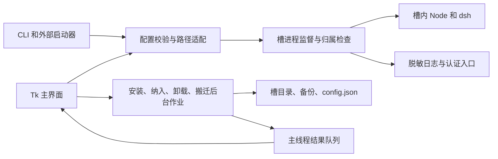

# DSH-TM 架构、可靠性与性能

本文面向维护者和需要核对数据、进程或性能边界的用户。日常操作见[使用手册](dsh管理器使用说明.md)，自动化调用见 [CLI JSON v1](agent-api.md)。

## 执行路径

| 代码 | 职责 |
| --- | --- |
| [dsh_manager.pyw](../dsh_manager.pyw) | Tk 窗口、槽卡片、用户操作、进度与结果队列。App 还从这里分派 `--cli`、自检和进程监督入口。 |
| [dsh-tm.py](../dsh-tm.py) | CLI 状态、健康检查、`doctor`、启动和停止。JSON 使用固定字段和枚举。卸载、搬迁与纳入有自己的交互入口。 |
| [dsh_platform.py](../dsh_platform.py)、[dsh_config_guard.py](../dsh_config_guard.py) | 查找运行时、展开相对路径、构造子进程环境、生成平台启动器，并校验槽和有效端口。 |
| [dsh_slot_process.py](../dsh_slot_process.py)、[dsh_kill.py](../dsh_kill.py) | 枚举监听端口、识别实例、监督 Web 子进程、脱敏、确认停止。 |
| [dsh_install_ops.py](../dsh_install_ops.py)、[dsh_adopt.py](../dsh_adopt.py)、[dsh_registry.py](../dsh_registry.py) | 官方包安装、纳入现有安装、版本清单缓存、分配槽名和端口。 |
| [dsh_uninstall_ops.py](../dsh_uninstall_ops.py)、[dsh_move.py](../dsh_move.py) | 移出、接回、备份、卸载与迁移，包含路径、安全和提交前后的验证。 |
| [dsh_health.py](../dsh_health.py)、[dsh_drift.py](../dsh_drift.py)、[dsh_ui_prefs.py](../dsh_ui_prefs.py) | 槽体检、插件和配置变更指纹，以及槽卡片显示偏好。 |

## 隔离与状态判定

- `config.json` 的 `versions` 登记逻辑槽和有效路径。`<base>` 随安装根变化，`<home>`、`<self>`、`<npm_global>` 和 macOS 的 `<appsupport>` 按当前环境展开。卡片的真实版本从实际入口所在包的清单读取。GUI 和 CLI 都检查槽键和端口配置。
- 每槽以自己的 Node 和 `bin.js` 启动，注入独立 `DSH_HOME`、`TEMP` 和 `TMP`。macOS 还设置 `TMPDIR`。默认 Web 监听使用回环地址。槽隔离属于运行时和文件布局，进程继承当前操作系统用户权限。
- 端口有监听时核对进程入口、PID 和进程出生标识。确认是本槽后才报告有效运行或进行停止。遇到未知监听者报告占用。启动等待默认 20 秒，冷启动或插件初始化超出窗口时可以继续等待确认。
- 监督进程逐行读取 Node 输出，在持久化前遮盖入口 token。认证 URL 单独传回启动本槽的管理器进程。旧实例可以继续运行，重新启动管理器时可能需要从已登录的浏览器访问或重启槽来取得认证入口。
- 在同一 HTTP cookie 容器中依次认证 `rc.1` 和 `rc.5` 后，再请求两个槽的无 token 地址，实测两者均为 200。这里验证的是两版 dsh 的会话行为。

## 安装、迁移和卸载

1. 指定实装版本或发行标签后分配槽名和端口。npm 预检区分网络不可达与版本不存在。macOS 优先使用本地缓存，仅在真实 npm 输出 `ETARGET` 或 `E404` 时用在线优先模式向同一源核对一次。默认源网络错误或安装超时后最多切换镜像一次，配置仅对相应子进程生效。
2. macOS 在版本根中的暂存目录安装并验证入口、包版本和启动器。在写锁内重读配置并核对槽名、路径与端口后，移动暂存目录并原子替换 JSON。发布目录已经移动而配置写入失败时，将目录移回暂存区回收。Windows 的既有安装路径先登记再安装，失败时清理并撤销登记。
3. 纳入先检查来源、数据位置、运行时和依赖。复制纳入保留来源。已有槽移出时只改登记，接回可以复用原目录。有冲突时分配新端口，并更新对应的启动器。
4. 卸载先确认目标和停止，再复制必要用户数据，按文件清单及 SHA-256 验证。路径护栏拒绝越界操作并避免跟随符号链接或 junction。文件备份失败时中止删除。迁移检查空间并先复制到暂存区，校验后提交路径，随后清理旧目录。

原子替换保护读取者免于读到半截 JSON。槽目录与配置之间跨两个文件系统操作，强制终止和磁盘故障仍需要排查残留目录与配置备份。

## 性能由哪些机制保障

| 场景 | 实现与成本 | 验证方式 |
| --- | --- | --- |
| 窗口响应 | 下载、复制、备份、自检及监听探测在工作线程运行。Tk 主线程约每 25 毫秒处理一次结果队列，每批最多 100 个回调。批量安装结束后统一刷新卡片。自动和手动自检合并同时到达的请求，报告写完后替换旧文件。 | 原生 Tk 进度测试检查前台、后台、恢复、操作限制和一次结算。[窗口回归](../scripts/test-macos-install-gui.py) · [自检调度回归](../scripts/test-manager-logic.py) |
| 展示与轮询 | 界面按前台 1.5 秒、失焦 6 秒、最小化 10 秒选择刷新间隔。监听者在独立线程逐槽探测，每轮结束后等待 0.8 秒。界面取最近快照。进程枚举成本随槽数和系统而变。 | 槽状态及归属回归覆盖未监听、同端口外来进程和 PID 重用。[主界面判定](../scripts/test-manager-logic.py) · [进程回归](../scripts/test-slot-process.py) |
| 版本列表和安装 | 版本列表进程内缓存 10 分钟。请求失败或手动刷新时重新查询。macOS npm 单次下载请求限制为 45 秒，外层每次命令等待上限 10 分钟。发生重试时，整个安装可能长于单次命令上限。缓存、registry 延迟、插件下载、原生依赖和磁盘性能都会影响总耗时。 | npm 回归覆盖两源超时、旧缓存、清理失败暂存及生命周期子进程。用真实 npm 和本机隔离 registry 验证了旧依赖缓存恢复。[macOS 回归](../scripts/test-macos-platform.py) |
| 磁盘和备份 | 扫描用目录遍历与剪枝。卸载备份跳过链接目标，Windows 可用 robocopy，多文件用流式哈希校验。搬迁需要容纳待复制的数据。校验会额外读取数据，耗时随文件数、大小和存储设备变化。 | 回归验证同尺寸损坏、目标已存在、空间与越界、链接及备份失败。[文件安全](../scripts/test-storage-safety.py) · [搬迁](../scripts/test-move.py) |
| 健康检查和变更 | 启动时浅查入口及必要目录，用户主动调用深度体检才检查较重的项目。插件和配置变更使用少量指纹定期比对。 | [槽体检](../scripts/test-health.py) · [变更检测](../scripts/test-drift.py) |

表中时限是代码参数。发布报告应把实测耗时和测试环境另行记录。测安装时分别记录冷缓存、暖缓存、下载源和 dsh 版本。测文件操作时记录文件数、大小与卷类型。测界面时记录系统、Tk 版本、槽数以及窗口是否在前台。

后台自检的本机对照在 Apple Silicon macOS 27.0.1、Tk 9、零槽下进行。测试 Node 的版本探测刻意等待 2 秒，自检约 2.25 秒内处理了 44 个 Tk 定时回调。启动自检加两次手动请求共运行一个子进程，报告与相同输入的终端自检逐字节一致。

## 验收与发布

| 验收视角 | 需要观察的结果 |
| --- | --- |
| 零槽新用户 | 下载正确架构，核对 SHA-256，打开管理器，选择实际安装根。安装进度可恢复，成功后卡片显示实际版本。 |
| 并行版本用户 | 安装期间可以启停旧槽。不同槽的数据、运行时和端口独立。访问新槽未认证为 401，认证后为 200。 |
| 升级及排障用户 | 沿用现有配置并体检。验证失效缓存、端口冲突和网络失败能准确报告。可取消卸载，确认后核对备份和端口释放。 |
| 自动化调用方 | `doctor --json`、`start`、`stop` 的机器字段和退出码符合契约。日志不写入完整认证 URL。 |
| 发布维护者 | 用同一提交在目标架构构建并解包测试。核对文件名、版本号、签名状态和 SHA-256。Release 分别列出实机、托管 CI、替身和待验收环境。 |

macOS 使用 [macos.yml](../.github/workflows/macos.yml) 按原生架构构建，Windows 使用 [windows-release.yml](../.github/workflows/windows-release.yml) 运行回归与便携包检查。硬件、系统版本和 GUI 证据以对应版本报告为准。[历史验收](test-coverage-v0.1.12.md)
